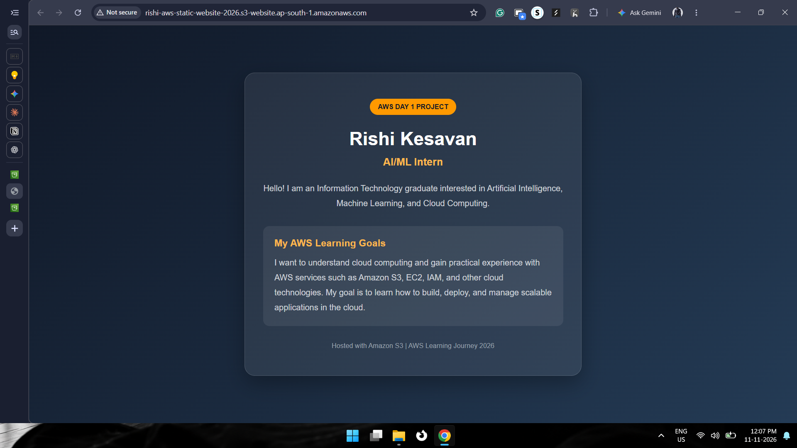
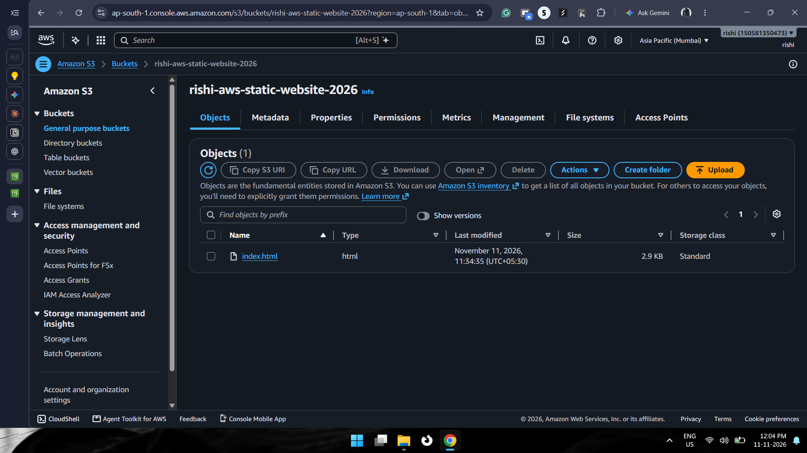
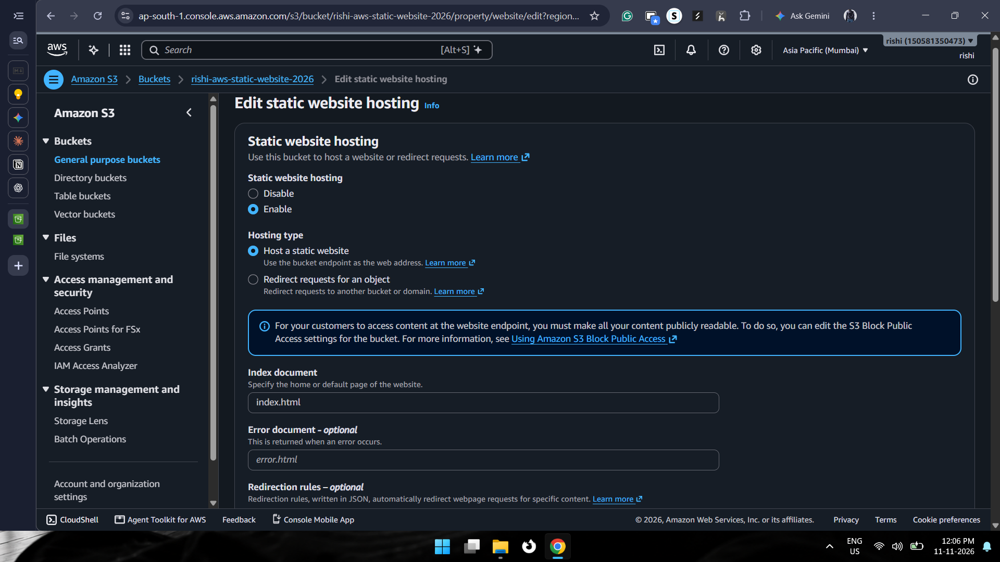
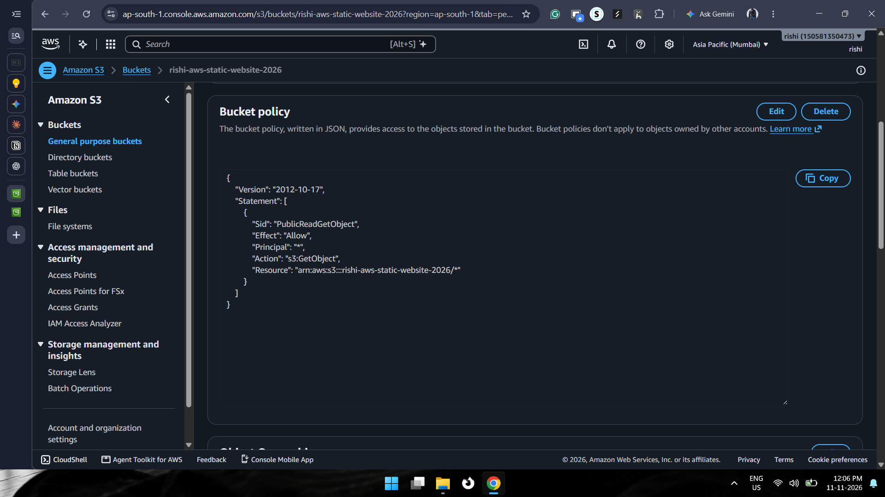
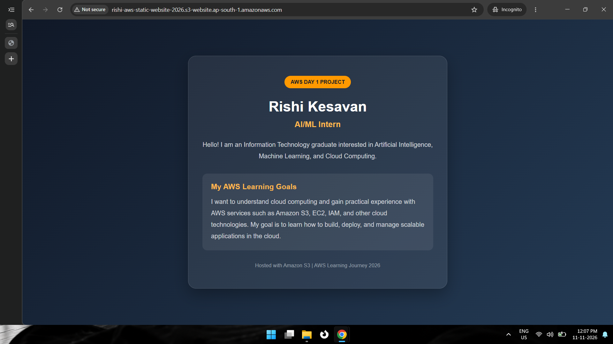

# AWS S3 Static Website Hosting


A beginner-friendly AWS cloud computing project demonstrating
how to deploy and host a public-facing static personal profile
website using **Amazon S3 (Simple Storage Service)**.

## 🌐 Project Demo

**Deployment Platform:** Amazon S3 Static Website Hosting

**AWS Region:** Asia Pacific (Mumbai) - `ap-south-1`

**Website Endpoint (Deployment Reference):**

`http://rishi-aws-static-website-2026.s3-website.ap-south-1.amazonaws.com`

> **Note:** This website was successfully deployed and tested using Amazon S3 Static Website Hosting as part of my AWS learning assignment. The AWS resources may be decommissioned after project completion to avoid ongoing charges. Therefore, the endpoint may no longer be accessible.

## 📌 Project Overview

The objective of this project was to build and deploy a
personal profile website using Amazon S3 Static Website Hosting.

The project demonstrates fundamental AWS concepts such as
cloud storage, bucket configuration, access management,
resource-based policies, and static website deployment.

Instead of managing a traditional web server, Amazon S3
serves the static website files directly through a website
endpoint.

## 🎯 Objectives

- Understand Amazon S3 and object storage.
- Create and configure an S3 bucket.
- Upload website files to Amazon S3.
- Enable Static Website Hosting.
- Configure public access permissions.
- Create an S3 Bucket Policy using JSON.
- Deploy and verify a publicly accessible website.

## 🛠️ Technologies Used

| Technology | Purpose |
|---|---|
| Amazon S3 | Cloud storage and static website hosting |
| HTML5 | Website structure |
| CSS3 | Website styling |
| JSON | S3 bucket policy configuration |
| AWS Management Console | Cloud resource management |

## 🏗️ Architecture

```text
             User / Browser
                   |
                   |
              HTTP Request
                   |
                   v
          Amazon S3 Website Endpoint
                   |
                   v
              S3 Bucket
                   |
                   v
              index.html
                   |
                   v
          Bucket Policy Validation
                   |
                   v
           Public Read Access
                   |
                   v
          Website Displayed
```

## ⚙️ Implementation Steps

### 1. Create an Amazon S3 Bucket

- Opened the AWS Management Console.
- Navigated to Amazon S3.
- Created a general-purpose S3 bucket.
- Selected the Asia Pacific (Mumbai) region.
- Configured Object Ownership with ACLs disabled.
- Disabled Block Public Access for the dedicated
  public website bucket.

**Bucket Name:** `rishi-aws-static-website-2026`

**AWS Region:** `ap-south-1`

### 2. Create the Website

Created an `index.html` file containing:

- Personal introduction.
- Current professional role.
- Background and interests.
- AWS learning objectives.

Used HTML5 and CSS3 to build a responsive
personal profile page.

### 3. Upload Files to Amazon S3

- Opened the newly created S3 bucket.
- Uploaded `index.html`.
- Verified that the upload completed successfully.
- Confirmed the uploaded object's content type was `text/html`.

### 4. Enable Static Website Hosting

Navigated to:

S3 Bucket → Properties → Static Website Hosting

Configured the following:

| Setting | Configuration |
|---|---|
| Static Website Hosting | Enabled |
| Hosting Type | Host a static website |
| Index Document | index.html |
| Error Document | Not configured |

### 5. Configure the S3 Bucket Policy

Configured a bucket policy to grant public read access
to objects stored inside the website bucket.

The policy uses `s3:GetObject` to allow anonymous
visitors to retrieve website files.

**Bucket Policy:**

```json
{
  "Version": "2012-10-17",
  "Statement": [
    {
      "Sid": "PublicReadGetObject",
      "Effect": "Allow",
      "Principal": "*",
      "Action": "s3:GetObject",
      "Resource": "arn:aws:s3:::rishi-aws-static-website-2026/*"
    }
  ]
}
```

**Policy Explanation:**

| Element | Description |
|---|---|
| Version | Specifies the IAM policy language version |
| Effect | Allows the specified operation |
| Principal | `*` represents everyone |
| Action | `s3:GetObject` allows object retrieval |
| Resource | Applies to all objects in the specified bucket |

**Security Consideration:**

The bucket policy grants public read access only.
It does not grant public upload or deletion permissions.

### 6. Test Website Accessibility

- Opened the S3 website endpoint.
- Verified that the profile page loaded successfully.
- Tested anonymous access using an Incognito browser window.

**Result:** Successfully deployed and accessed the
personal profile website through the Amazon S3
website endpoint.

## 📸 Project Screenshots

The following screenshots demonstrate the deployment
and configuration process.

### 1. Live Website



### 2. S3 Bucket and Uploaded Object



### 3. Static Website Hosting Configuration



### 4. S3 Bucket Policy



### 5. Public Website Access Verification




## 📚 Key Learnings

Through this project, I gained practical experience
with the following AWS concepts:

- Amazon S3 and object storage.
- S3 bucket creation and configuration.
- AWS Regions.
- Object Ownership and ACLs.
- Block Public Access settings.
- Server-side encryption (SSE-S3).
- Static Website Hosting.
- S3 Bucket Policies.
- IAM policy structure and JSON.
- Amazon Resource Names (ARNs).
- Public read permissions using `s3:GetObject`.

## 🚀 Future Improvements

- Configure Amazon CloudFront for HTTPS delivery.
- Register a custom domain name.
- Add a custom error document.
- Improve the website with additional sections.
- Explore automated deployment workflows.

## ⚠️ Security Notes

- This project intentionally uses public read access.
- Do not store confidential information in the bucket.
- Never expose AWS access keys or secret credentials.
- The S3 static website endpoint uses HTTP.
- For production hosting, consider Amazon CloudFront
  with HTTPS.

## 👨‍💻 Author

**Rishi Kesavan**

B.Tech Information Technology Graduate | AI/ML Intern

Interested in Artificial Intelligence, Machine Learning,
Data Analytics, and Cloud Computing.

- GitHub: [Check Here](https://github.com/rishikesavan-data)
- LinkedIn: [Click to Connect](https://www.linkedin.com/in/rishikesavan-data/)

---

⭐ If you find this project useful, feel free to explore
the repository and share your feedback.
